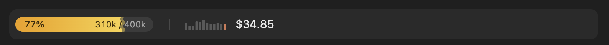
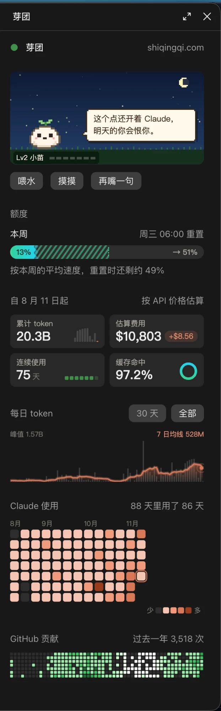

# ~/.claude

My Claude Code setup: instructions, settings, hooks, skills, and two mods that change Claude Code's own interface. It lives in git so that a new Mac is one clone away.

```sh
git clone https://github.com/QingqiShi/claude.git ~/.claude
~/.claude/bootstrap.sh
```

`bootstrap.sh` needs `git`, `node` and `npm`, `jq`, `gh`, and the `claude` CLI on the PATH.

## Mods

Mods are plugins that redraw parts of Claude Code. `settings.json` loads both mods in every session, and desktop sessions reload a mod as soon as its folder changes.

### dev-band, the band above the prompt



- **Context**: a liquid meter of the context used. It measures against the 400k auto-compact window, not the model's 1M window.
- **Cost**: the session cost, with a sparkline of the cost of each turn and a rolling number when it goes up.
- **Agents**: running subagents circle as comets on the right, so the band does not shift when they start and stop.

### sprout (芽团), a pane beside the chat



Long-lived numbers that one session cannot show:

- **A pixel pet that talks back.**
  - It grows through 9 levels as the total tokens grow, from Lv1 种子 to Lv9 传说金树 at 1000B, and never loses a level.
  - Its mood follows the quota, the streak, the time of day and merged PRs.
  - It has buttons to feed it, pat it, or get another line.
- **Quota**: this week's and the 5-hour quota, each with a forecast for its reset.
- **Usage**: total tokens, estimated API cost, the streak and the cache hit rate, from the first transcript on. A daily trend and a heatmap go with them.
- **GitHub**: the contribution heatmap.

If the window is too narrow for the pane to open by itself, open it with `/sprout`.

**Where the numbers come from.** `mods/sprout/scripts/scan.mjs` reads every transcript in `projects/`, plus every import in `sprout-imports/`. It keeps its progress in `sprout-cache/`, so later scans read only new lines.

**Bring in another Mac's history.** On the other Mac:

```sh
cd ~/.claude
find projects -name '*.jsonl' |
  tar czf ~/transcripts.tgz -T -
```

Then extract the archive here into `~/.claude/sprout-imports/<device-name>/`. The next scan counts it once, even where the two Macs share messages.

<br clear="right">

## What else is here

| Path | What it is |
|---|---|
| `CLAUDE.md` | My instructions for every project |
| `settings.json` | Permissions, environment, enabled plugins, and the mods to load |
| `statusline-command.sh` | The status line |
| `hooks/` | Guards on tool calls, with tests in `hooks/tests/`. They:<br>• refuse links to other repos in public GitHub text, because GitHub keeps such references forever<br>• refuse a subagent that has no explicit model<br>• nudge the main agent to delegate after a run of tool calls<br>• move a stale `HANDOFF.md` out of a reused worktree<br>• check search commands |
| `skills/` | My own skills: `agent-instructions`, `auto-improve`, `merge-dependabot`, `pr-standards`, `prepare-for-pr` |
| `mods/` | The two mods above |
| `bootstrap.sh`, `update.sh` | Install, and later update, everything that is not mine (next section) |

## What is not in git, and why

`.gitignore` ignores everything, then lets back in only the paths above. The rest stays on this Mac for one of two reasons.

**Other people's code is installed, not copied.** Plugins and skills by others are installed from their source, so that they keep getting updates and this repo never holds a stale copy. `bootstrap.sh` installs them, and `update.sh` updates them:

| What | Installed with |
|---|---|
| Plugins: `codex`, `frontend-design`, `skill-creator`, `claude-code-setup` | `claude plugin install`, from `enabledPlugins` in `settings.json` |
| `vercel-cli` skill | `npx skills add github.com/vercel/vercel` |
| `improve-codebase-architecture`, `codebase-design`, `domain-modeling`, `grilling` skills | `npx skills add github.com/mattpocock/skills` |
| `gh-stack` skill and its `gh stack` extension | `gh skill install` and `gh extension install` |
| `playwright-cli` skill | the `@playwright/cli` npm package |

**Private or rebuilt data stays local.**
- Session transcripts (`projects/`) and `sprout-imports/` hold whole conversations, code included.
- `sprout-cache/` and Claude Code's own caches are rebuilt by themselves.

## Keep the installed parts up to date

```sh
~/.claude/update.sh
```

It updates every plugin and installed skill to its latest version, and writes what it did to `.last-skill-update`. Nothing changes in git.

<details>
<summary>Run it on the 1st of every month (launchd)</summary>

```sh
cat > ~/Library/LaunchAgents/dev.qingqi.claude-skills-update.plist <<'PLIST'
<?xml version="1.0" encoding="UTF-8"?>
<!DOCTYPE plist PUBLIC "-//Apple//DTD PLIST 1.0//EN" "http://www.apple.com/DTDs/PropertyList-1.0.dtd">
<plist version="1.0"><dict>
  <key>Label</key><string>dev.qingqi.claude-skills-update</string>
  <key>ProgramArguments</key>
  <array>
    <string>/bin/zsh</string><string>-lc</string>
    <string>"$HOME/.claude/update.sh" >> "$HOME/.claude/.skill-update.log" 2>&1</string>
  </array>
  <key>StartCalendarInterval</key><dict>
    <key>Day</key><integer>1</integer><key>Hour</key><integer>10</integer><key>Minute</key><integer>0</integer>
  </dict>
</dict></plist>
PLIST
launchctl load ~/Library/LaunchAgents/dev.qingqi.claude-skills-update.plist
```

The job runs `update.sh` at 10:00 in a login shell, so `node` and `claude` are on the PATH. To stop it, run `launchctl unload` on the plist, then delete the file.

</details>

## Add something new

- **My own skill or mod**: put it in `skills/<name>/` or `mods/<name>/` and commit it. A new mod also needs its folder added to `CLAUDE_CODE_PLUGIN_DIRS` in `settings.json`; separate the folders with `:`.
- **A plugin by someone else**: install it as usual. It lands in `settings.json`, and nothing else is needed.
- **A skill by someone else**:
  1. Install it:
     - from npm: `npx skills add <repo> --skill <name> -g --agent claude-code --copy`
     - from GitHub: `gh skill install <owner/repo> <name> --agent claude-code --scope user`
  2. Add its `"<source>|<name>"` line to `SKILLS_CLI_PACKAGES` or `GH_SKILL_PACKAGES` in both `bootstrap.sh` and `update.sh`.
  3. Add `skills/<name>` to `.gitignore`.
  4. Confirm that git ignores it: `git check-ignore skills/<name>`.
