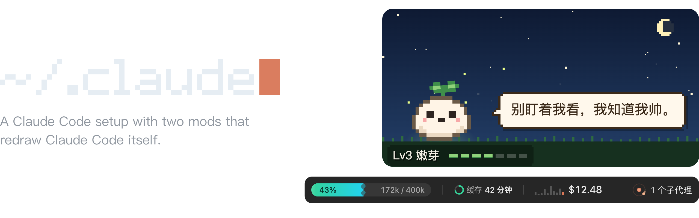
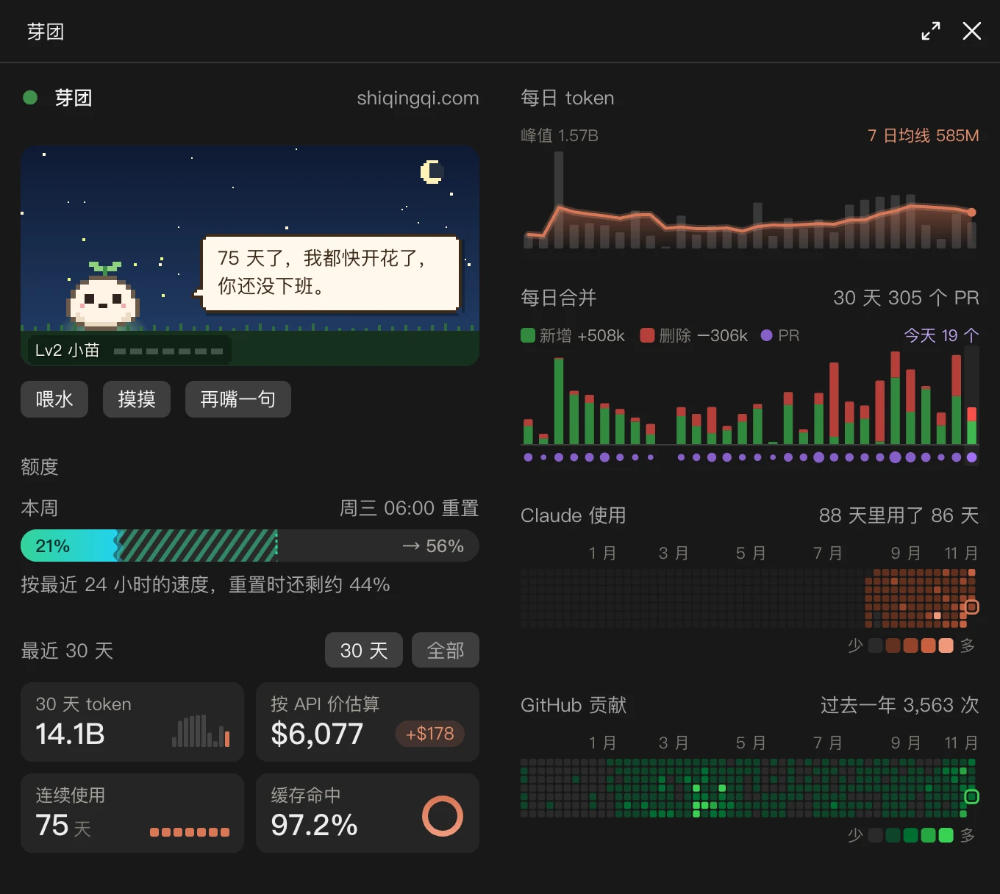

<p align="center">
  <picture>
    <source media="(prefers-color-scheme: light)" srcset="docs/banner-light.png">
    
  </picture>
</p>

Instructions, settings, hooks and skills for Claude Code, plus the two mods below. One clone sets up a new Mac.

```sh
git clone https://github.com/QingqiShi/claude.git ~/.claude
~/.claude/bootstrap.sh
```

## dev-band

A band above the prompt: context used, time left on the prompt cache, session cost, and running subagents.

<picture>
  <source media="(prefers-color-scheme: light)" srcset="mods/dev-band/screenshot-light.png">
  
</picture>

## sprout 芽团

A pane beside the chat, for the numbers one session cannot show:

- a pixel pet that grows with every token you spend
- this week's quota and where it will end up
- tokens, cost, streak and cache hits, by day and over a year
- the PRs merged each day, and the GitHub heatmap

It opens by itself when the window is wide enough. Otherwise, run `/sprout`. To count another Mac's history, copy its `~/.claude/projects/` into `~/.claude/sprout-imports/<device-name>/`.

<picture>
  <source media="(prefers-color-scheme: light)" srcset="mods/sprout/screenshot-light.webp">
  
</picture>

## What is here

- `CLAUDE.md`: my instructions for every project
- `settings.json`: permissions, plugins, and the mods to load
- `hooks/`: guards on tool calls
- `skills/`: my own skills
- `mods/`: dev-band and sprout

Other people's plugins and skills stay out of git. `bootstrap.sh` installs them, and `~/.claude/update.sh` updates them.
