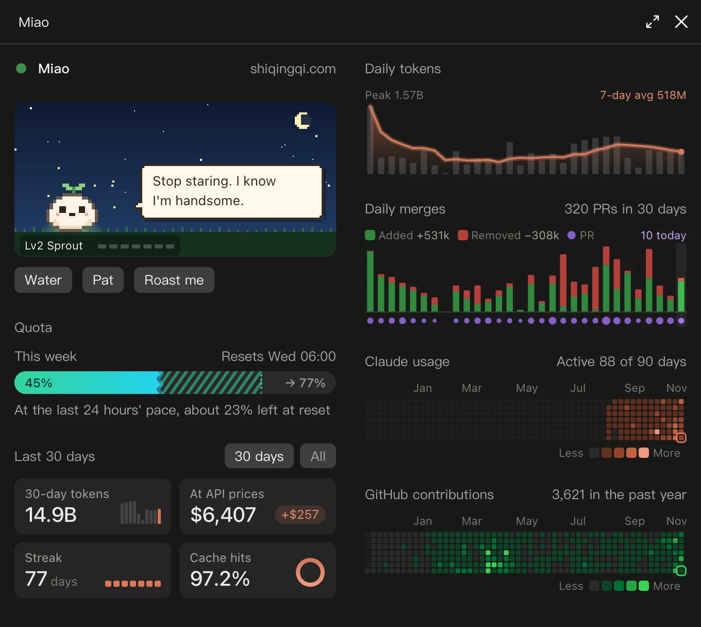
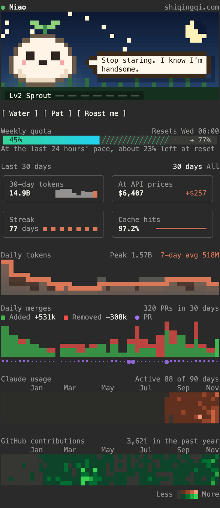

English | [中文](README.zh.md)

<p align="center">
  <picture>
    <source media="(prefers-color-scheme: light)" srcset="docs/banner-light.png">
    
  </picture>
</p>

Instructions, settings, hooks and skills for Claude Code, plus the two mods below. One clone sets up a new Mac.

```sh
git clone https://github.com/QingqiShi/claude.git ~/.claude
~/.claude/bootstrap.sh
```

## dev-band

A band above the prompt: context used, time left on the prompt cache, session cost, and running subagents.

<picture>
  <source media="(prefers-color-scheme: light)" srcset="mods/dev-band/screenshot-light.png">
  
</picture>

## sprout 小苗

小苗 (Miao) is a pane beside the chat, for the numbers one session cannot show:

- a pixel pet that grows with every token you spend
- this week's quota and where it will end up
- tokens, cost, streak and cache hits, by day and over a year
- the PRs merged each day, and the GitHub heatmap

It opens by itself when the window is wide enough. Otherwise, run `/sprout`.

It speaks Chinese when Claude Code's `language` setting is Chinese (or, with no such setting, when the locale in `LC_ALL`, else `LANG`, is Chinese), and English otherwise.

The same pane runs in the desktop app, on the phone, and in the terminal. A terminal cannot draw SVG, so there Miao paints the pet, the charts and the heatmaps cell by cell, two pixels to a cell, and folds its layout to fit the pane's height.

<p>
  <picture>
    <source media="(prefers-color-scheme: light)" srcset="mods/sprout/screenshot-en-light.webp">
    
  </picture>
  
</p>

### Install

Copy `mods/sprout` from this repository to `~/.claude/mods/sprout`:

```sh
git clone --depth 1 https://github.com/QingqiShi/claude.git /tmp/qingqi-claude
mkdir -p ~/.claude/mods
cp -R /tmp/qingqi-claude/mods/sprout ~/.claude/mods/sprout
```

Then have Claude Code load it, in the `env` block of your `~/.claude/settings.json`. If `CLAUDE_CODE_PLUGIN_DIRS` already has a value, add this one after a colon.

```json
{
  "env": {
    "CLAUDE_CODE_PLUGIN_DIRS": "~/.claude/mods/sprout"
  }
}
```

Restart Claude Code and the pane opens. Or send this to Claude Code on your Mac and let it do the steps above:

> Install Miao for me: copy the folder mods/sprout from the repository https://github.com/QingqiShi/claude to ~/.claude/mods/sprout, then in ~/.claude/settings.json add ~/.claude/mods/sprout to CLAUDE_CODE_PLUGIN_DIRS under env (after a colon if it already has a value). When it is done, remind me to restart Claude Code.

It needs `node` 18 or newer for the usage history (it reads `~/.claude/projects/` with [`scan.mjs`](mods/sprout/scripts/scan.mjs); nothing leaves your Mac unless you sync it to Buddy, below) and `gh` signed in for the merges and the GitHub heatmap; without them those sections stay away.

### See the pet on your phone

[Buddy (搭子)](https://buddy.qingqi.dev) shows the same pet on a phone, live. Under the pane, Miao asks once: “See Miao on your phone too?” Press “Sync to phone”, and your browser opens Buddy, where you sign in (a passkey, no password) and confirm that this Mac may post to your account. From then on the Mac uploads its state at most every five minutes, and only when something changed; the pane says when it last synced and links to your page. A quiet Mac means the pet sleeps, which is right.

What goes up is what the page shows: tokens and cost by day, the quota readings, the GitHub heatmap levels, the number of PRs and lines merged each day, the pet's level and how often you fed and patted it. Repository names, PR titles and anything else about what you work on stay on the Mac. Each Mac signs its uploads with its own Ed25519 key, kept in the macOS Keychain (the item `sprout-buddy`), so only this Mac can post as itself; Buddy adds the days of all your Macs together, and each Mac pulls that total back so the pane shows every Mac.

- `/sprout sync` starts the connection, or uploads right away once connected.
- `/sprout disconnect` forgets the link but keeps the key on this Mac, so connecting it again makes it the same Mac on Buddy and its days count once. Buddy lists the Mac, and counts its days, until you remove it there; removing it there also deletes the days it sent.
- `/sprout server <url>` points this Mac at another Buddy (a preview deployment, or your own); `/sprout server default` goes back. `SPROUT_BUDDY_SERVER` in the environment does the same for one process.
- Pressing “No thanks” hides the offer; `/sprout sync` brings it back.

To count a Mac that does not sync, copy its `~/.claude/projects/` into `~/.claude/sprout-imports/<device-name>/`. Once that Mac syncs to Buddy itself, remove its folder, or its days count twice.

## What is here

- `CLAUDE.md`: my instructions for every project
- `settings.json`: permissions, plugins, and the mods to load
- `hooks/`: guards on tool calls
- `skills/`: my own skills
- `mods/`: dev-band and sprout (小苗)

Other people's plugins and skills stay out of git. `bootstrap.sh` installs them, and `~/.claude/update.sh` updates them.
