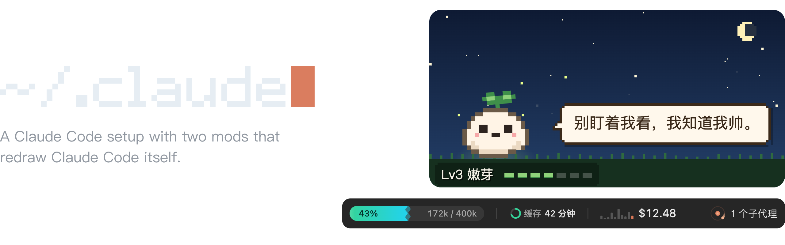
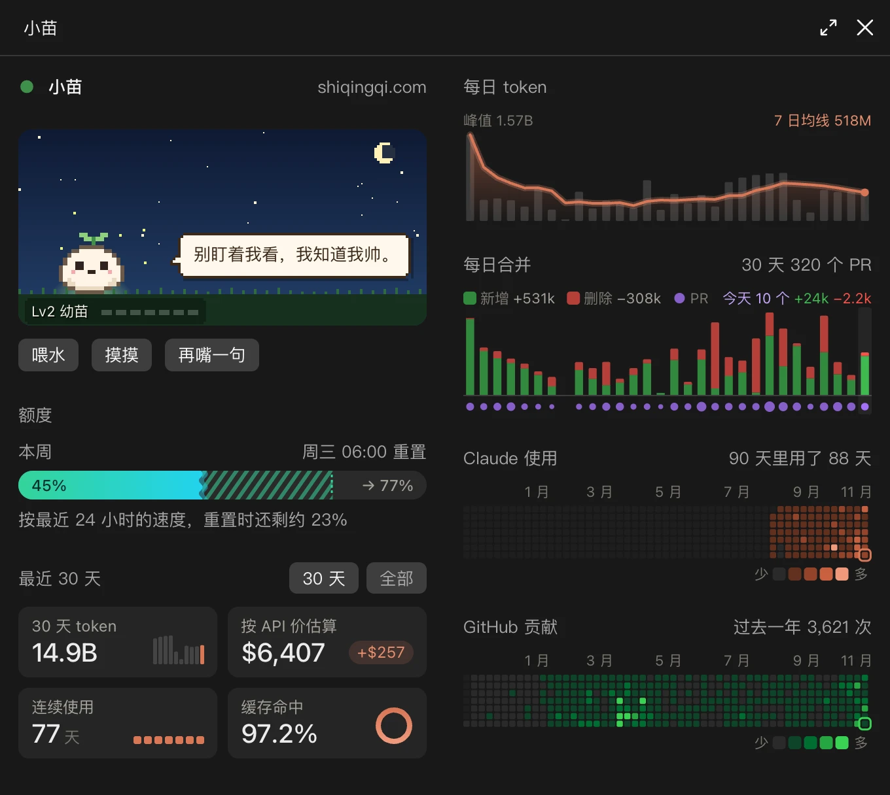
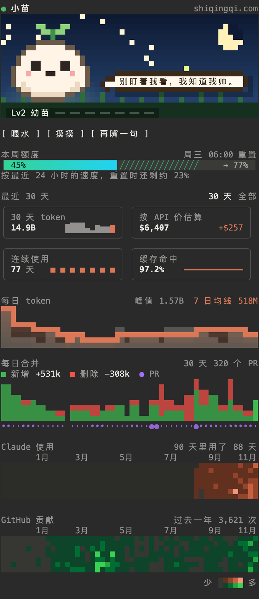

[English](README.md) | 中文

<p align="center">
  <picture>
    <source media="(prefers-color-scheme: light)" srcset="docs/banner-light.png">
    
  </picture>
</p>

这里放着我给 Claude Code 用的指令、设置、hooks 和 skills，还有下面两个 mod。换了新 Mac，克隆一次就能配好。

```sh
git clone https://github.com/QingqiShi/claude.git ~/.claude
~/.claude/bootstrap.sh
```

## dev-band

输入框上方的一条信息栏：上下文用了多少、提示缓存还有多久过期、这次会话花了多少钱，以及正在运行的子代理。

<picture>
  <source media="(prefers-color-scheme: light)" srcset="mods/dev-band/screenshot-light.png">
  
</picture>

## sprout 小苗

小苗是聊天旁边的一个面板，放的是单次会话里看不到的数字：

- 一只像素宠物，你用掉的每个 token 都会让它长大一点
- 本周额度用了多少，到重置时大概会用到多少
- token、花费、连续使用天数和缓存命中率，可以按天看，也可以看一整年
- 每天合并的 PR，以及 GitHub 贡献热力图

窗口够宽时它会自己打开；不够宽的话，运行 `/sprout`。

Claude Code 的 `language` 设置是中文时，它就说中文；没有这项设置时，看系统语言（先看 `LC_ALL`，没有再看 `LANG`）是不是中文。其他情况下它说英文。

桌面 app、手机和终端里都是同一个面板。终端画不了 SVG，所以在终端里，小苗会一格一格地画出宠物、图表和热力图，每格两个像素，并按面板的高度调整布局。

<p>
  <picture>
    <source media="(prefers-color-scheme: light)" srcset="mods/sprout/screenshot-zh-light.webp">
    
  </picture>
  
</p>

### 安装

把这个仓库里的 `mods/sprout` 复制到 `~/.claude/mods/sprout`：

```sh
git clone --depth 1 https://github.com/QingqiShi/claude.git /tmp/qingqi-claude
mkdir -p ~/.claude/mods
cp -R /tmp/qingqi-claude/mods/sprout ~/.claude/mods/sprout
```

然后在 `~/.claude/settings.json` 的 `env` 里让 Claude Code 加载它。如果 `CLAUDE_CODE_PLUGIN_DIRS` 已经有值，就用冒号隔开，把这个路径加在后面。

```json
{
  "env": {
    "CLAUDE_CODE_PLUGIN_DIRS": "~/.claude/mods/sprout"
  }
}
```

重启 Claude Code，面板就出来了。也可以把下面这段话发给 Mac 上的 Claude Code，让它替你完成上面几步：

> 帮我装上小苗：把仓库 https://github.com/QingqiShi/claude 里的 mods/sprout 文件夹复制到 ~/.claude/mods/sprout，再在 ~/.claude/settings.json 的 env 里，把 ~/.claude/mods/sprout 加进 CLAUDE_CODE_PLUGIN_DIRS（如果它已经有值，就用冒号隔开加在后面）。装好后提醒我重启 Claude Code。

使用记录需要 `node` 18 或更新的版本（它用 [`scan.mjs`](mods/sprout/scripts/scan.mjs) 读取 `~/.claude/projects/`；除非你同步到下面说的搭子，否则数据不会离开你的 Mac）；合并记录和 GitHub 热力图需要已经登录的 `gh`。缺了它们，对应的部分就不显示。

### 在手机上看宠物

[搭子（Buddy）](https://buddy.qingqi.dev)能在手机上实时显示同一只宠物。面板下方，小苗会问一次：「手机上也想看小苗？」点「同步到手机」，浏览器会打开搭子。你在那里登录（用通行密钥，不用密码），并确认允许这台 Mac 往你的账号上传数据。之后 Mac 最多每五分钟上传一次状态，而且只在有变化时才传；面板上会显示上次同步的时间，并附上你页面的链接。Mac 没动静，宠物就会睡着，这是正常的。

上传的就是页面上显示的内容：每天的 token 和花费、额度读数、GitHub 热力图的深浅等级、每天合并的 PR 数和代码行数、宠物的等级，以及你给它喂水和摸摸它的次数。仓库名、PR 标题，以及其他和你在做什么有关的信息，都留在 Mac 上。每台 Mac 用自己的 Ed25519 密钥给上传的内容签名，密钥存在 macOS 钥匙串里（条目名为 `sprout-buddy`），所以只有这台 Mac 能以它自己的身份上传。搭子会把你所有 Mac 的每日数据加在一起，每台 Mac 再把这个总数拉回来，所以面板上显示的是所有 Mac 的合计。来你页面的人也能在那里给宠物浇水、摸摸它；面板大约 15 分钟内就会知道，宠物会有反应，他们浇水和摸摸的次数也会加到你的次数里。

- `/sprout sync` 开始连接；已经连上的话，立即上传一次。
- `/sprout disconnect` 断开连接，但密钥仍留在这台 Mac 上，所以再连上时，它在搭子上还是同一台 Mac，数据只算一次。在你到搭子上删掉这台 Mac 之前，搭子会一直列出它，并计入它的数据；在那里删掉它，也会删除它上传过的数据。
- `/sprout server <url>` 让这台 Mac 改连另一个搭子（预览部署，或你自己部署的）；`/sprout server default` 改回默认。在环境变量里设置 `SPROUT_BUDDY_SERVER` 效果一样，但只对当前进程有效。
- 点「不用」会隐藏这个提示；`/sprout sync` 能让它重新出现。

想把一台不同步的 Mac 也算进来，就把它的 `~/.claude/projects/` 复制到 `~/.claude/sprout-imports/<device-name>/`。等那台 Mac 自己同步到搭子以后，要删掉这个文件夹，不然它的数据会算两遍。

### 在 Codex 里

同一只宠物也能住进 Codex 的侧栏，以插件的形式安装。在那里它统计的是你的 Codex 用量：用 [`codex/scripts/scan.mjs`](mods/sprout/codex/scripts/scan.mjs) 读取 `~/.codex/` 下的会话文件，向 Codex CLI 询问额度，并按 OpenAI 官网价格页估算花费（价格每天重新读取一次）。

```sh
codex plugin marketplace add QingqiShi/claude
codex plugin add sprout@qingqi
```

重启 Codex，说一句「打开小苗」。它需要 `node` 22.18 或更新的版本，因为 Codex 直接运行这个 mod 的 TypeScript，没有构建步骤。更新时运行 `codex plugin marketplace upgrade qingqi`，再重新添加一次插件；卸载用 `codex plugin remove sprout@qingqi`。宠物的状态保存在 `~/.codex/sprout/`。

在 Codex 里，宠物还会对你的工作有反应：任务跑久了它会泡茶，上下文压缩时留张纸条，测试失败了也有话说。额度紧张时，点天上的云可以向 Tibo 求雨。CatGPT 每天来串一次门。点等级条可以打开成长图鉴。

Codex 部分的代码在 [`mods/sprout/codex/`](mods/sprout/codex)。mod 的 hooks 在那里原样运行，底下是一个小小的、替代 Claude Code 引擎的实现；宿主可以改动的地方都写在 [`hooks/host.ts`](mods/sprout/hooks/host.ts) 里。

## 这里有什么

- `CLAUDE.md`：我给所有项目的指令
- `settings.json`：权限、插件，以及要加载的 mod
- `hooks/`：在工具调用时把关的检查
- `skills/`：我自己写的 skills
- `mods/`：dev-band 和 sprout（小苗）

别人的插件和 skills 不放进 git。`bootstrap.sh` 负责安装，`~/.claude/update.sh` 负责更新。
